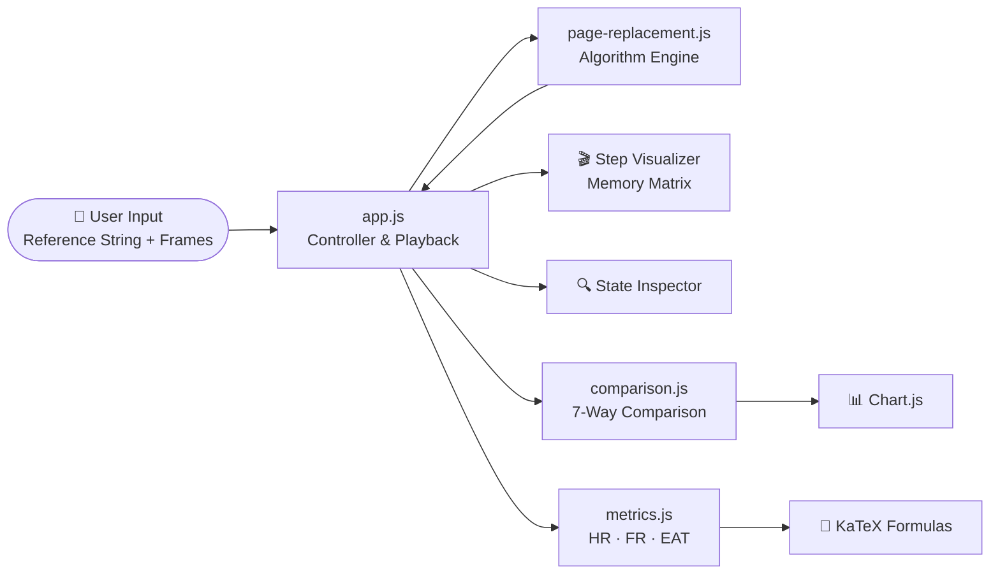

<div align="center">


<a href="#">
  
</a>

<br/>


<br/>

**A modern, interactive web app for simulating, comparing, and *deeply* understanding page replacement algorithms.**
<br/>
Built for computer science students, educators, and systems engineers.

[🚀 Quick Start](#-quick-start) •
[✨ Features](#-key-features) •
[🧠 Algorithms](#-the-seven-algorithms) •
[🧪 Bélády Lab](#-béládys-anomaly-lab) •
[📐 Formulas](#-the-math-behind-it) •
[🤝 Contribute](#-contributing)

</div>

---

## 📸 Preview

<div align="center">

> 🖼️ *Add your screenshots / GIF here — they make the biggest first impression!*

| 🎬 Step Visualizer | 📊 Multi-Algorithm Comparison | 🧪 Bélády's Anomaly Lab |
|:---:|:---:|:---:|
| `assets/visualizer.gif` | `assets/comparison.png` | `assets/belady.png` |

</div>

---

## 📑 Table of Contents

- [✨ Key Features](#-key-features)
- [🧠 The Seven Algorithms](#-the-seven-algorithms)
- [🎬 Classroom-Style Step Visualizer](#-classroom-style-step-visualizer)
- [📊 Multi-Algorithm Comparison](#-multi-algorithm-comparison)
- [🧪 Bélády's Anomaly Lab](#-béládys-anomaly-lab)
- [📐 The Math Behind It](#-the-math-behind-it)
- [🏗️ Architecture](#️-architecture)
- [📁 Project Structure](#-project-structure)
- [⚡ Quick Start](#-quick-start)
- [🧪 Testing with Node.js](#-testing-with-nodejs)
- [🗺️ Roadmap](#️-roadmap)
- [🤝 Contributing](#-contributing)
- [📜 License](#-license)

---

## ✨ Key Features

<table>
<tr>
<td width="50%" valign="top">

### 🧠 7 Algorithms, One Place
Classic textbook policies (FIFO, OPT, LRU) side by side with real-world ones (Clock, LFU, **ARC**) and a **learned ML-based** predictor.

</td>
<td width="50%" valign="top">

### 🎬 Step-by-Step Playback
Play, pause, step forward/back and reset — with **3 speed modes** and a color-coded memory matrix like the one your professor draws on the board.

</td>
</tr>
<tr>
<td width="50%" valign="top">

### 🔍 Live State Inspector
Peek *inside* each algorithm: FIFO queues, LRU recency lists, clock hands & reference bits, LFU counters, ARC ghost caches and ML risk scores.

</td>
<td width="50%" valign="top">

### 📊 Head-to-Head Comparison
Run all 7 policies on the same input, get ranked scorecards 🏆, hit/fault ratios, and an interactive Chart.js bar chart.

</td>
</tr>
<tr>
<td width="50%" valign="top">

### 🧪 Bélády's Anomaly Lab
Watch FIFO get **worse** with **more** memory — with side-by-side matrices explaining exactly why.

</td>
<td width="50%" valign="top">

### 📚 Built-In Theory Guide
Paging fundamentals, thrashing, a master comparison matrix, KaTeX-rendered formulas and a live **EAT calculator**.

</td>
</tr>
</table>

---

## 🧠 The Seven Algorithms

| # | Algorithm | Core Idea | Bélády-Safe? | Best For |
|:-:|:---|:---|:-:|:---|
| 1️⃣ | **FIFO** — First-In, First-Out | Evict the oldest resident page by arrival time | ❌ | Simplicity, teaching |
| 2️⃣ | **OPT** — Optimal / Bélády's MIN | Evict the page unused for the longest *future* time | ✅ | Theoretical lower bound |
| 3️⃣ | **LRU** — Least Recently Used | Evict the least recently referenced page (temporal locality) | ✅ | General workloads |
| 4️⃣ | **Clock** — Second-Chance | O(1) LRU approximation with 1-bit reference flags + circular buffer | ⚠️ | Hardware-efficient OS kernels |
| 5️⃣ | **LFU** — Least Frequently Used | Evict the page with the lowest reference count | ⚠️ | Stable popularity distributions |
| 6️⃣ | **ARC** — Adaptive Replacement Cache | IBM's self-tuning balance of recency (T₁) & frequency (T₂) with ghost caches (B₁, B₂) | ⚠️ | Shifting, mixed workloads |
| 7️⃣ | **ML-Based** — Learned / Predictive | Online model using recency, frequency & Markov transitions to predict reuse distance | ⚠️ | Pattern-rich access streams |

<sub>✅ Stack algorithm, immune to Bélády's Anomaly &nbsp;•&nbsp; ❌ Susceptible &nbsp;•&nbsp; ⚠️ Not a strict stack algorithm — see the in-app theory guide</sub>

<details>
<summary><b>🔎 Click to see what the Live State Inspector shows for each algorithm</b></summary>

<br/>

| Algorithm | Inspector View |
|:---|:---|
| **FIFO** | `Oldest [ P1 ] → ... → [ Pn ] Newest` arrival queue |
| **LRU** | `LRU [ P1 ] ↔ ... ↔ [ Pn ] MRU` recency track |
| **OPT** | Future lookahead table for every resident frame |
| **Clock** | Circular buffer with hand pointer and reference bits (`1 → 0` second chances) |
| **LFU** | Live frequency counter per frame |
| **ARC** | T₁, T₂, B₁, B₂ lists and adaptive target `p` |
| **ML-Based** | Feature vectors, transition likelihoods and predicted reuse-risk scores |

</details>

---

## 🎬 Classroom-Style Step Visualizer

```
 Reference →   7    0    1    2    0    3    0    4  ...
 ┌─────────┬────┬────┬────┬────┬────┬────┬────┬────┐
 │ Frame 0 │ 7  │ 7  │ 7  │ 2  │ 2  │ 2  │ 2  │ 4  │
 │ Frame 1 │    │ 0  │ 0  │ 0  │ 0  │ 0  │ 0  │ 0  │
 │ Frame 2 │    │    │ 1  │ 1  │ 1  │ 3  │ 3  │ 3  │
 └─────────┴────┴────┴────┴────┴────┴────┴────┴────┘
              🟡   🟡   🟡   🔴   🟢   🔴   🟢   🔴
```

| Color | Meaning |
|:-:|:---|
| 🟢 | **Page Hit** — page already resident |
| 🟡 | **Empty Frame Allocation** — fault, no eviction needed |
| 🔴 | **Page Fault & Eviction** — victim page highlighted |

**Controls:** ▶️ Play &nbsp;⏸️ Pause &nbsp;⏭️ Next &nbsp;⏮️ Previous &nbsp;🔄 Reset
**Speeds:** ⚡ Fast `0.6s` &nbsp;•&nbsp; 🚶 Normal `1.2s` &nbsp;•&nbsp; 🐢 Slow `2.0s`

---

## 📊 Multi-Algorithm Comparison

Run all **7 algorithms simultaneously** on identical reference strings and frame counts:

- 🏆 Ranked performance scorecards with a **Lowest Faults** badge
- 📋 Comparison table with hit ratio, fault ratio and architectural notes
- 📈 Interactive Chart.js bar chart — page faults vs page hits across all policies

---

## 🧪 Bélády's Anomaly Lab

> *"Give it more memory and it gets slower?!"* — every OS student, the first time.

Using the classic reference string:

```
[1, 2, 3, 4, 1, 2, 5, 1, 2, 3, 4, 5]
```

| Frames | FIFO Page Faults |
|:-:|:-:|
| 3 | **9** |
| 4 | **10** 😱 |

The lab renders both matrices side by side and shows *why* it happens: FIFO is not a **stack algorithm**, so the set of pages in memory with *m* frames is not guaranteed to be a subset of the set with *m + 1* frames:

$$M_t(m) \not\subseteq M_t(m+1)$$

---

## 📐 The Math Behind It

**Hit Ratio & Fault Ratio**

$$HR = \frac{\text{Page Hits}}{\text{Total References}} \qquad FR = \frac{\text{Page Faults}}{\text{Total References}} = 1 - HR$$

**Effective Access Time**

$$EAT = (1 - p)\cdot t_{mem} + p \cdot t_{fault}$$

where $p$ is the page-fault rate, $t_{mem}$ the memory access time, and $t_{fault}$ the page-fault service time.

> 🧮 The app includes a **real-time EAT calculator** — tweak the parameters and watch how even a tiny fault rate slows memory access dramatically.

---

## 🏗️ Architecture



---

## 📁 Project Structure

```
cpu-scheduling-simulator-main/
├── 📄 index.html              # Entry point: tabs, visualizer & theory guide
├── 🎨 css/
│   └── styles.css             # Dark-theme glassmorphism styling
├── ⚙️ js/
│   ├── page-replacement.js    # Algorithm engine & Bélády anomaly logic
│   ├── app.js                 # Controller, step playback, DOM updates
│   ├── metrics.js             # Metric helper utilities
│   ├── comparison.js          # Multi-algorithm comparison logic
│   ├── scheduling.js          # CPU scheduling algorithms (companion module)
│   └── gantt-chart.js         # Gantt chart visualizer (companion module)
└── 📘 README.md
```

---

## ⚡ Quick Start

### 🖱️ Option 1 — Just open it

No install, no build. Double-click **`index.html`** and it runs in any modern browser (Chrome, Firefox, Edge, Safari).

### 🌐 Option 2 — Deployed server

open 👉 **https://page-replacement-simulator-nu.vercel.app/**]

---

## 🧪 Testing with Node.js

The core algorithms export cleanly, so you can test them headless:

```bash
node -e "
const { fifo, lru, optimal } = require('./js/page-replacement.js');
const ref = [7, 0, 1, 2, 0, 3, 0, 4, 2, 3, 0, 3, 2, 1, 2, 0, 1, 7, 0, 1];
console.log('FIFO:', fifo(ref, 3).totalFaults, 'faults');
console.log('LRU:', lru(ref, 3).totalFaults, 'faults');
console.log('OPT:', optimal(ref, 3).totalFaults, 'faults');
"
```

**Expected output** (classic textbook string, 3 frames):

| Algorithm | Page Faults | |
|:---|:-:|:---|
| FIFO | **15** | 🥉 |
| LRU | **12** | 🥈 |
| OPT | **9** | 🥇 theoretical best |

---

## 🗺️ Roadmap

- [x] FIFO, OPT, LRU, Clock, LFU, ARC, ML-Based
- [x] Step-by-step visualizer with live state inspector
- [x] Bélády's Anomaly Lab
- [x] 7-way comparison with charts
- [x] KaTeX theory guide + EAT calculator
- [ ] Export simulation results as CSV / PDF
- [ ] Working-set & thrashing simulator
- [ ] Light theme toggle
- [ ] Shareable simulation links

---

## 🤝 Contributing

Contributions, issues and feature requests are welcome! 💜

1. 🍴 Fork the repository
2. 🌿 Create a branch: `git checkout -b feature/amazing-feature`
3. 💾 Commit: `git commit -m "Add amazing feature"`
4. 🚀 Push: `git push origin feature/amazing-feature`
5. 🔃 Open a Pull Request

---

## 📜 License

Distributed under the **MIT License**. Free to use, learn from, and build upon.

---

<div align="center">


⭐ **If this project helped you finally understand page replacement, give it a star!** ⭐

